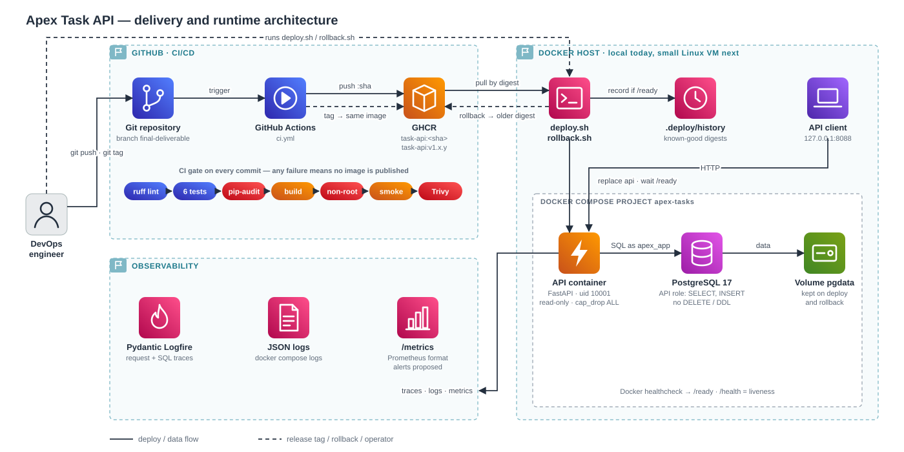

# Apex Task API — DevOps assessment

A small FastAPI + PostgreSQL API with a full path from commit to release:
**test → build → scan → publish → deploy → monitor → roll back.** Runs locally with Docker Compose.



| | |
| --- | --- |
| Image | `ghcr.io/abdu11ahbilal/devops-assignment-apex-arabia/task-api` |
| API URL | `http://127.0.0.1:8088` |
| Endpoints | `/health` (alive) · `/ready` (DB reachable) · `POST/GET /tasks` · `/metrics` |
| Current release | `v1.1.0` |

## Run it

Needs Docker with Compose v2 and Git Bash (on Windows).

```bash
cp .env.example .env                 # set both passwords; LOGFIRE_TOKEN is optional
scripts/deploy.sh v1.1.0             # pull the released image from GHCR and start it
curl -s http://127.0.0.1:8088/health
curl -s -X POST http://127.0.0.1:8088/tasks -H 'content-type: application/json' -d '{"title":"demo"}'
curl -s http://127.0.0.1:8088/tasks
```

To build from source instead: `docker compose up -d --build --wait`.
Run the tests: start Postgres with `docker run -d -e POSTGRES_DB=apex_test -e POSTGRES_USER=apex -e POSTGRES_PASSWORD=apex -p 127.0.0.1:5432:5432 postgres:17-alpine`, then `pip install -r requirements-dev.txt && ruff check . && pytest` (the tests apply `db/01-schema.sql` themselves).

## CI pipeline ([ci.yml](.github/workflows/ci.yml))

Each step must pass before the next one runs. Nothing is published if any step fails.

| # | Check | Fails when |
| --- | --- | --- |
| 1 | `ruff` lint + security rules | bad or unsafe Python |
| 2–7 | 6 pytest tests against real PostgreSQL | API or DB behaviour breaks |
| 8 | `pip-audit` on `requirements.lock` | a locked Python package has a known vulnerability |
| 9 | Non-root check | container would run as root |
| 10 | Full-stack smoke test: the image in Compose, write + read through the API, API's DB role can't `DELETE` | the image can't start, reach the DB, or has too many DB rights |
| 11 | Trivy scan | a HIGH/CRITICAL vulnerability with a fix exists |

## Versioning

There is **no version number in any file** (`pyproject.toml` has none). Git decides the version:

| You do | CI does | Image tags in GHCR |
| --- | --- | --- |
| push commit `eabb376` | test, build, scan, publish | `task-api:eabb376…` (full commit SHA) |
| `git tag v1.0.2 && git push origin v1.0.2` | **no rebuild**: adds a second name to the same image | `task-api:v1.0.2` → same image as `:eabb376…` |

- You pick the number by hand when you create the tag. Nothing bumps it automatically.
- Inside the app, `/health` shows the commit (`"version": "eabb376"`), because the image was built before the tag existed.
- `deploy.sh` converts the tag to the image's fixed digest (`@sha256:…`). A tag can be moved to another image; a digest can't, so the deployed image is always exactly the one CI tested.
- **No image is pushed** when any CI step fails, or for pull requests (they are built and checked, never published).
- If a commit has no image, tagging it fails to release anything.

## Deploy and roll back

```bash
scripts/deploy.sh v1.1.0      # pull → apply schema/role → deploy by digest → wait for /ready
scripts/rollback.sh           # go back to the last version that passed /ready
```

Only successful deploys are written to `.deploy/history`. Rollback replaces only the API container; the database volume is untouched, and the script checks the row count is the same before and after.

## Security

- **Database least privilege:** the API connects as `apex_app`, which can only `SELECT` and `INSERT` on `tasks` — no `DELETE`, no schema changes, not a superuser. The admin role applies `db/01-schema.sql` and `db/02-app-role.sh` (on first start, and on every deploy).
- **Reproducible builds:** Python and PostgreSQL images pinned by digest; `requirements.lock` pins every package, scanned by `pip-audit`; the image by Trivy.
- **Container:** non-root user, read-only filesystem, all Linux capabilities dropped, ports on localhost only.
- **Secrets:** only in `.env` (git-ignored); CI uses GitHub's short-lived token; actions pinned to commits.

## Monitoring

- **Logs:** one JSON line per request — `docker compose logs api`.
- **Logfire:** traces of every request and SQL query (only if `LOGFIRE_TOKEN` is set).
- **Health:** `/health` = process alive, `/ready` = database reachable (used by Docker and `deploy.sh`).
- **Metrics:** `/metrics` — request count, latency, tasks created. Alert ideas: [decision memo](docs/decision-memo.md#alerts).

## Failure demos (real output in [`evidence/`](evidence/))

**1. CI blocks a bad commit** — a test was made to fail on purpose. Tests went red, the image step was skipped, and no image exists for that commit. The next commit fixed it. (`01`–`03`, `11`)

**2. Bad release, then rollback** — v1.0.1 added `PGSSLMODE=require` (force TLS to the DB). The local DB has no TLS:

1. `deploy.sh v1.0.1` → `/health` 200 but `/ready` 503, so the deploy fails. (`06`)
2. Logs and Logfire show `server does not support SSL, but SSL was required`. (`07`)
3. `rollback.sh` → back on v1.0.0, 5 tasks before and after. (`08`)
4. v1.0.2 removes the setting and adds the CI smoke test, which would have caught it. (`09`)

**3. Security hardening release** — v1.1.0 moved the API to the restricted DB role. Upgraded on the existing data (5 → 5 tasks), the role's `DELETE`/`DROP` are denied, and rolling back to v1.0.2 still works (6 → 6 tasks). (`12`)

## Docs

- [Architecture](docs/architecture.md) — diagrams and code map
- [Runbook](docs/runbook.md) — deploy, rollback, incidents, troubleshooting
- [Decision memo](docs/decision-memo.md) — choices, security, alerts, cloud cost
- [AI disclosure](docs/ai-disclosure.md)
