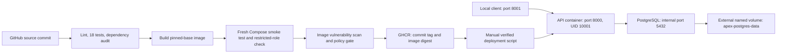

# Apex Operations API — Junior DevOps assessment

Candidate: Abdullah Bilal. A small FastAPI/PostgreSQL service demonstrating local deployment, CI release gates, persistent storage, failure investigation, and image-based rollback. No paid cloud resources, Apex production systems, real customers, or customer credentials are used.

## Architecture



## Prerequisites

- Docker Engine/Desktop and Docker Compose v2+; on Windows use WSL2 integration.
- Python 3.12 for the documented development workflow; Bash and Git.
- Host port `8001` free. PostgreSQL is not published on a host port.
- Internet access to pull pinned base images, application images and scanner databases.

## Reproduce from a clean checkout

```bash
git clone https://github.com/Abdu11ahBilal/Devops-Assignment-Apex-Arabia.git
cd Devops-Assignment-Apex-Arabia
bash scripts/bootstrap.sh
```

Bootstrap generates random local credentials in ignored `.env` (mode 0600), creates the external volume, starts PostgreSQL, applies an idempotent restricted application role, builds the local API image and verifies real database writes/reads. Existing credentials and existing database data are preserved. The database schema initializer runs automatically on an empty volume. The role initializer is also applied explicitly for existing volumes.

Bootstrap creates one synthetic smoke-test note. Repeated smoke tests create additional synthetic notes; they do not delete existing records.

```bash
docker compose ps
curl -i http://127.0.0.1:8001/health
curl -i http://127.0.0.1:8001/ready
curl -i http://127.0.0.1:8001/version
curl -fsS http://127.0.0.1:8001/notes
```

Interactive API documentation: <http://127.0.0.1:8001/docs>.

## Endpoints

| Method and path | Behaviour |
| --- | --- |
| `GET /health` | 200 when the API handles the request; independent of PostgreSQL |
| `GET /ready` | 200 after a successful database query; 503 when database/configuration is unavailable |
| `GET /version` | Application version label; image digest remains the exact release identity |
| `POST /notes` | JSON `{"text":"synthetic note"}`; 201 on creation, 422 on invalid input, 503 on database failure |
| `GET /notes` | Returns notes ordered by ID; 503 on database failure |

Notes must contain non-whitespace text and be at most 500 characters. SQL values are parameterized.

## Development and automated checks

```bash
python3 -m venv .venv
source .venv/bin/activate
python -m pip install -r requirements-dev.txt -c requirements.lock
python -m ruff check main.py tests scripts
python -m pytest -v
python -m pip_audit -r requirements.lock --strict
```

The 18 Python tests exercise API behaviour, invalid input, simulated database failure, request logging and local configuration generation. They mock database access and do not prove real database operation. `scripts/smoke.py` separately checks a running API against real PostgreSQL; CI also executes that fresh-stack check before publication.

```bash
python3 scripts/smoke.py --expected-version 0.3.0
docker compose exec -T api python - < scripts/check_db_role.py
```

For direct WSL development, the documented default connection is `127.0.0.1:15432`; a deliberately published database port and matching credentials are needed. The final Compose deployment instead uses internal hostname `db:5432` and a restricted role. Prefer Compose for reproduction.

## CI and deployment

`.github/workflows/ci.yml` runs on pushes to `main`, pull requests, and manual dispatch. Failed lint, tests, dependency audit, integration checks, scanner execution or image policy block image publication. Publication runs only for pushes to `main`, using the repository workflow token with job-scoped package-write permission. Actions and runtime base images are pinned by digest/commit.

CI uploads test/audit artifacts. Image findings without a listed fix remain visible; see [security policy and findings](docs/security.md). A green run does not mean zero vulnerabilities.

After a successful publish, copy **Deploy by digest** from the run summary:

```bash
bash scripts/deploy.sh 'ghcr.io/abdu11ahbilal/devops-assignment-apex-arabia@sha256:FULL_DIGEST' 0.3.0
```

The deployment script pulls that exact image, replaces only the API, verifies image identity, readiness and expected version, then saves the selected image in local `.env`. Rollback uses the same command with the previous known-good digest and version. It is a **manual rollback**, not an automatic guarantee.

The historical `0.1.0 → 0.2.0 → 0.1.0` demonstration is preserved under `evidence/release-*` and `evidence/rollback-*`.

## Submission guide

- [Runbook: deploy, rollback, incidents and troubleshooting](docs/runbook.md)
- [Decision memo and limitations](docs/decision-memo.md)
- [Metrics, alerts and operational logging proposal](docs/observability.md)
- [Security controls, scans and residual risk](docs/security.md)
- [Cost-aware cloud proposal — not deployed](docs/cloud-plan.md)
- [Controlled incident investigation](docs/incident-report.md)
- [AI-use disclosure](docs/ai-use-disclosure.md)
- [Requirement-to-evidence checklist](docs/assessment-checklist.md)
- [CI gate evidence and run links](evidence/ci-gate.txt)

## Scope limits

This is a local, single-host assessment deployment. It has no API authentication or TLS, no production HA, no deployed metrics backend and no demonstrated disaster-recovery restore. The API binds to host loopback. A Docker volume provides persistence, not a backup. Existing database changes are additive; incompatible schema migrations would need their own rollback strategy.
