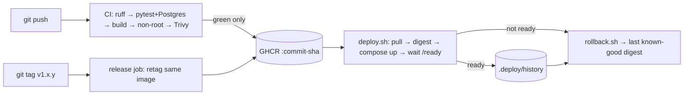

# Apex Task API — DevOps assessment

A small FastAPI + PostgreSQL task API, packaged as a non-root container, tested and scanned in
GitHub Actions, published to GHCR as an immutable commit-SHA image, promoted to release tags without
a rebuild, deployed with Docker Compose by `scripts/deploy.sh`, and recovered with
`scripts/rollback.sh`. Observability comes from JSON logs, Pydantic Logfire traces, health/readiness
checks and Prometheus metrics. Full diagrams: [docs/architecture.md](docs/architecture.md).



| | |
| --- | --- |
| Image | `ghcr.io/abdu11ahbilal/devops-assignment-apex-arabia/task-api` |
| Branch | `final-deliverable` |
| Compose project / URL | `apex-tasks` / `http://127.0.0.1:8088` |

## Prerequisites

- Docker Desktop or Docker Engine with Compose v2 (`docker compose version`)
- A POSIX shell for the scripts: Git Bash on Windows, any shell on Linux/macOS
- `curl`

## Quickstart (local build)

```bash
cp .env.example .env          # set POSTGRES_PASSWORD; LOGFIRE_TOKEN is optional
docker compose up -d --build --wait
```

```bash
curl -s http://127.0.0.1:8088/health          # {"status":"ok","version":"..."}
curl -s http://127.0.0.1:8088/ready           # {"status":"ready"}
curl -s -X POST http://127.0.0.1:8088/tasks -H 'content-type: application/json' -d '{"title":"first task"}'
curl -s http://127.0.0.1:8088/tasks
curl -s http://127.0.0.1:8088/metrics | grep -E '^(http_requests_total|tasks_created_total)'
```

Use `127.0.0.1`, not `localhost`: on some Windows machines `localhost` resolves to `::1`, where another service may be listening.

## Running tests locally

```bash
docker run -d --name apex-test-db -e POSTGRES_DB=apex_test -e POSTGRES_USER=apex -e POSTGRES_PASSWORD=apex -p 127.0.0.1:5432:5432 postgres:17-alpine
```

```bash
pip install -r requirements-dev.txt && ruff check . && pytest -v
```

The tests use a real PostgreSQL (`DATABASE_URL` defaults to the container above). CI does the same with a service container.

## CI/CD ([.github/workflows/ci.yml](.github/workflows/ci.yml))

| Stage | Job | What it does | Blocks on failure |
| --- | --- | --- | --- |
| Lint | `Lint and test` | `ruff check .` (pycodestyle, pyflakes, isort, bugbear, bandit `S` security rules) | yes |
| Test | `Lint and test` | 6 pytest tests against a PostgreSQL 17 service container; JUnit report uploaded | yes |
| Build | `Build, scan and publish image` (`needs: test`) | `docker build` with `APP_VERSION=<short sha>` and OCI labels | yes |
| Non-root | same | `id -u` inside the image must not be `0` | yes |
| Smoke | same | run the image against a throwaway PostgreSQL; `/ready` must return 200 | yes |
| Scan | same | Trivy (pinned by digest), fails on fixable HIGH/CRITICAL | yes |
| Publish | same (push events only) | push `task-api:<commit-sha>` to GHCR | — |
| Release | `Promote tested image` (tags `v*.*.*`) | `docker buildx imagetools create` retags the commit's existing image to `:v1.x.y` (no rebuild) | fails if the commit never passed CI |

The workflow's default permission is `contents: read`. Only the image and release jobs get `packages: write`. Actions are pinned to commit SHAs.

**Automated checks (10):**
1. `ruff check .` (lint + bandit security rules)
2. `test_health_reports_liveness_and_version`
3. `test_ready_when_database_is_reachable`
4. `test_ready_returns_503_when_database_is_unreachable`
5. `test_created_task_is_persisted_and_listed`
6. `test_blank_or_missing_title_is_rejected`
7. `test_metrics_expose_request_and_task_counters`
8. Container non-root check
9. Container smoke test: built image + PostgreSQL, `/ready` must return 200
10. Trivy image vulnerability scan

## Release, deploy, rollback

```bash
git tag v1.0.0 && git push origin v1.0.0    # after the commit's CI run is green
scripts/deploy.sh v1.0.0                     # pull → resolve digest → replace api → wait for /ready
scripts/rollback.sh                          # back to the newest known-good digest ≠ running one
scripts/rollback.sh v1.0.0                   # or roll back to an explicit tag/digest
```

- **Build once, promote:** a release tag points at the same bytes that passed tests and Trivy.
- **Deploy by digest:** `deploy.sh` resolves the tag to `image@sha256:…` and runs that, because tags can move and digests cannot.
- **Known-good history:** after `/ready` passes, `deploy.sh` appends `<label> <digest>` to `.deploy/history`. A failed deploy is never recorded. `rollback.sh` picks the newest entry that isn't running now.
- **Data safety:** only the `api` container is replaced. The `pgdata` volume is untouched, and `rollback.sh` checks that the `tasks` row count is the same before and after.

## Observability

**JSON logs** (`docker compose logs api`): uvicorn's server logs and one line per request:

```json
{"ts": "2026-10-31T17:46:51+0000", "level": "INFO", "logger": "apex.api", "msg": "request", "method": "POST", "path": "/tasks", "status": 201, "duration_ms": 32.8}
```

- **Logfire:** if `LOGFIRE_TOKEN` is set, FastAPI requests and psycopg SQL calls are traced, and logs are mirrored. If it isn't set, nothing is exported and the app still works.
- **Health:** `/health` is liveness and never touches the DB. `/ready` is readiness (`SELECT 1`), and the Docker healthcheck and `deploy.sh` both use it.
- **Metrics:** `/metrics` exposes `http_requests_total{method,path,status}`, `http_request_duration_seconds` and `tasks_created_total`.
- **Alerts:** the proposed alerts (not-ready, 5xx ratio, p95 latency, no traffic) are in [docs/decision-memo.md](docs/decision-memo.md#observability-and-alert-proposal).

## Security summary

- Secrets live only in `.env` (git-ignored). `.env.example` has placeholders. CI uses the short-lived `GITHUB_TOKEN`.
- The container runs as UID 10001 with a read-only root filesystem, `cap_drop: ALL` and `no-new-privileges`. Ports bind to `127.0.0.1`, and the DB isn't published.
- Least-privilege workflow permissions. Actions are SHA-pinned, and Trivy is pinned by digest (the March 2026 trivy-action compromise, CVE-2026-33634).
- All SQL is parameterised. Input is validated by Pydantic. `/ready` doesn't leak connection details.
- Accepted gaps and trade-offs: [docs/decision-memo.md](docs/decision-memo.md#security-trade-offs).

## Failure demonstrations (evidence)

| File | Content |
| --- | --- |
| [01-ci-green.txt](evidence/01-ci-green.txt) | First green pipeline, image published |
| [02-ci-failure-blocked.txt](evidence/02-ci-failure-blocked.txt) | Intentional failing test: CI red, image job skipped |
| [03-ci-fixed.txt](evidence/03-ci-fixed.txt) | Fix commit restores green |
| [04-release-tags.txt](evidence/04-release-tags.txt) | Release tags promoted in GHCR |
| [05-deploy-v1.0.0.txt](evidence/05-deploy-v1.0.0.txt) | Successful deployment |
| [06-deploy-v1.0.1-failed.txt](evidence/06-deploy-v1.0.1-failed.txt) | Faulty release fails readiness |
| [07-investigation.txt](evidence/07-investigation.txt) | Logs, health vs readiness, root cause |
| [08-rollback.txt](evidence/08-rollback.txt) | Rollback to v1.0.0, data preserved |
| [09-deploy-v1.0.2.txt](evidence/09-deploy-v1.0.2.txt) | Fix-forward release |
| [10-logfire-export-check.txt](evidence/10-logfire-export-check.txt) | Logfire ingestion check |
| [11-test-results.txt](evidence/11-test-results.txt) | Lint + 6 pytest results from the CI log |

**Scenario 1: CI blocks a bad commit.**
1. A commit adds an intentionally failing test.
2. The `Lint and test` job fails, so the `Build, scan and publish image` job is skipped and no image is pushed for that SHA. A release tag can't be cut from that SHA either.
3. A fix commit turns CI green again.

An unplanned real example also happened: commit `6ee503a` had a Dockerfile syntax error; the *Build* step failed and nothing was published ([run 41227484146](https://github.com/Abdu11ahBilal/Devops-Assignment-Apex-Arabia/actions/runs/41227484146)).

**Scenario 2: faulty runtime configuration in a release.**
1. `v1.0.1` adds `ENV PGSSLMODE=require` to the Dockerfile (a "require TLS to the database" change).
2. CI passes, because the tests run outside the image.
3. On deploy, the local PostgreSQL has no TLS. `/health` stays 200, but `/ready` returns 503 and `deploy.sh` fails the readiness gate without recording the release as known-good.
4. `docker compose logs api` and the Logfire `GET /ready` trace both show `server does not support SSL, but SSL was required`.
5. `scripts/rollback.sh` restores the v1.0.0 digest with the `tasks` row count unchanged.
6. `v1.0.2` reverts the setting (fix forward) and adds the prevention below.

**Prevention (shipped in v1.0.2):** CI now runs the built image against a throwaway PostgreSQL and requires `/ready` = 200 (step *Smoke test the image against PostgreSQL*). Unit tests run outside the image, which is why v1.0.1 got through.

## Repository layout

```
app/            main.py (routes, middleware, metrics) · database.py · models.py · logging_config.py
tests/          conftest.py · test_api.py
scripts/        deploy.sh · rollback.sh
.github/workflows/ci.yml
docs/           architecture.md · runbook.md · decision-memo.md · ai-disclosure.md
evidence/       captured CI, deploy, incident and rollback output
Dockerfile · compose.yaml · .env.example · requirements*.txt · pyproject.toml
```

**Docs:**
- [Runbook](docs/runbook.md): deploy, rollback, incident response, troubleshooting
- [Decision memo](docs/decision-memo.md): architecture, security trade-offs, cost-aware cloud path
- [AI-use disclosure](docs/ai-disclosure.md)

## Demo script for the review

```bash
scripts/deploy.sh v1.0.2                                   # deploy a release by digest
curl -s -X POST http://127.0.0.1:8088/tasks -H 'content-type: application/json' -d '{"title":"demo"}'
scripts/deploy.sh v1.0.1                                   # faulty release → readiness gate fails
docker compose logs --tail 20 api | grep -i ssl            # investigate root cause
scripts/rollback.sh                                        # restore known-good, data preserved
curl -s http://127.0.0.1:8088/health && cat .deploy/history
```
