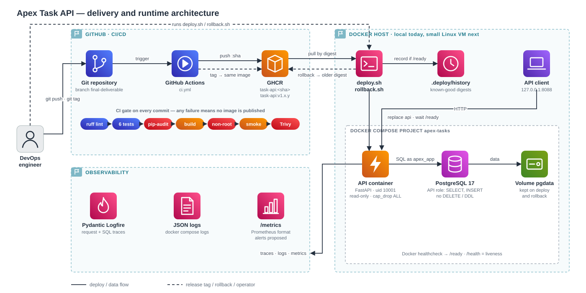

# Architecture

## How to read it

1. **GitHub · CI/CD** — every pushed commit runs the CI gate. Only if all six steps pass is the image
   pushed to GHCR as `task-api:<commit-sha>`. A `v1.x.y` tag adds a second name to that same image.
2. **Docker host** — `deploy.sh` pulls a release by digest, replaces the API container and waits for
   `/ready`. Good deploys are saved in `.deploy/history`; `rollback.sh` redeploys the previous one.
3. **Compose project** — the API talks to PostgreSQL; data lives in the `pgdata` volume, which deploys
   and rollbacks never touch.
4. **Observability** — Logfire traces, JSON logs and `/metrics` come from the API container.

## Code map

| File | What it does |
| --- | --- |
| `app/main.py` | Endpoints, request logging and metrics |
| `app/database.py` | Table creation and SQL queries |
| `app/models.py` | Input/output validation |
| `app/logging_config.py` | JSON logs and Logfire setup |
| `scripts/deploy.sh`, `scripts/rollback.sh` | Deploy a version, go back to the last good one |
| `.github/workflows/ci.yml` | The CI pipeline |
| `docs/architecture.svg` | This diagram |
