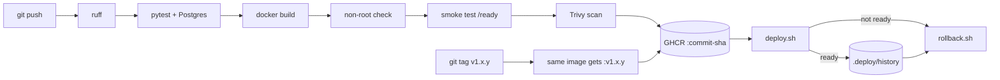
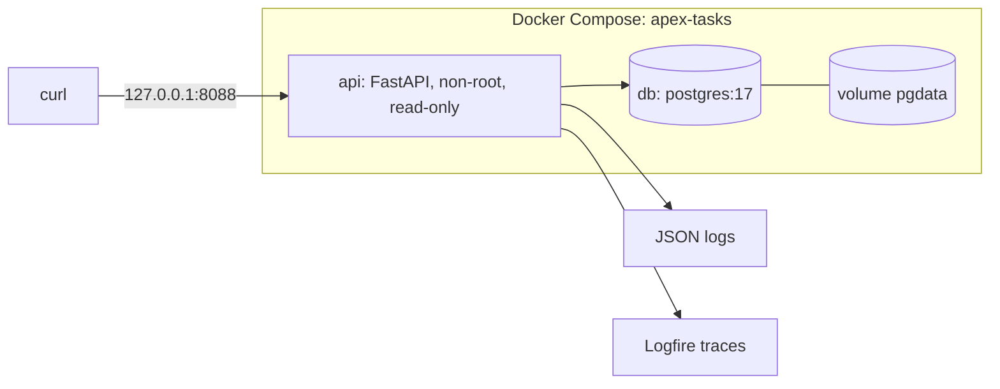

# Architecture

## Pipeline

## Runtime

## Code map

| File | What it does |
| --- | --- |
| `app/main.py` | Endpoints, request logging and metrics |
| `app/database.py` | Table creation and SQL queries |
| `app/models.py` | Input/output validation |
| `app/logging_config.py` | JSON logs and Logfire setup |
| `scripts/deploy.sh`, `scripts/rollback.sh` | Deploy a version, go back to the last good one |
| `.github/workflows/ci.yml` | The CI pipeline above |
