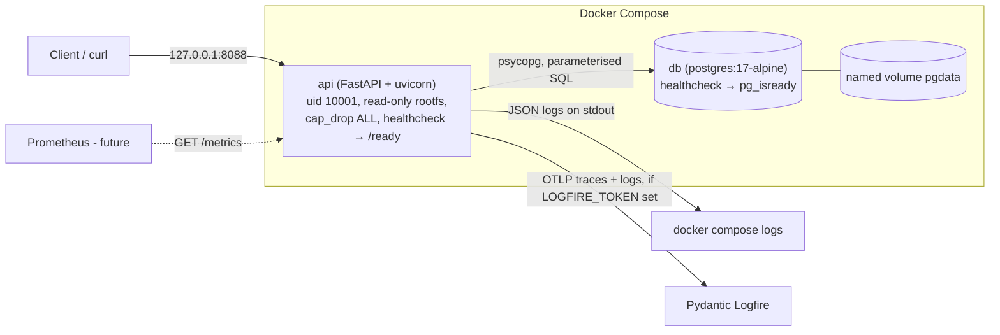

# Architecture

## Delivery pipeline (commit → release → deploy → rollback)

```mermaid
flowchart LR
    dev[Developer push] --> gha
    subgraph gha[GitHub Actions: ci.yml]
        lint[ruff lint + security rules] --> test[pytest vs PostgreSQL service]
        test --> build[docker build]
        build --> nonroot[non-root check]
        nonroot --> smoke[smoke test: image + PostgreSQL, /ready = 200]
        smoke --> trivy[Trivy scan HIGH/CRITICAL]
        trivy --> push["push ghcr.io/…/task-api:&lt;commit-sha&gt;"]
    end
    tag[git tag v1.x.y] --> promote["release job: retag sha image as v1.x.y (no rebuild)"]
    push --> ghcr[(GHCR)]
    promote --> ghcr
    ghcr --> deploy["scripts/deploy.sh v1.x.y<br/>pull → resolve digest → compose up → wait /ready"]
    deploy -- ready --> history[(.deploy/history<br/>known-good digests)]
    deploy -- not ready --> rollback["scripts/rollback.sh<br/>redeploy last known-good digest"]
    history --> rollback
```

Any failing step stops the chain: no image is pushed for a commit that failed lint, tests, the
non-root check, the container smoke test or the vulnerability scan, and a release tag can only point at an image that exists,
i.e. at a commit that passed CI.

## Runtime (one host, Docker Compose project `apex-tasks`)

| Endpoint | Purpose |
| --- | --- |
| `GET /health` | Liveness. Process is up; returns running version (commit SHA). Never touches the DB. |
| `GET /ready` | Readiness. `SELECT 1` against PostgreSQL; `503` if unreachable. Used by the Docker healthcheck and `deploy.sh`. |
| `POST /tasks` | Create a task (`title` 1–200 chars, not blank). |
| `GET /tasks` | List tasks. |
| `GET /metrics` | Prometheus text format: `http_requests_total{method,path,status}`, `http_request_duration_seconds`, `tasks_created_total`. |

## Code map

| File | Responsibility |
| --- | --- |
| `app/main.py` | Routes, request middleware (metrics + one JSON log line per request), startup schema creation |
| `app/database.py` | PostgreSQL schema and queries (short-lived psycopg connections) |
| `app/models.py` | Pydantic request/response models (input validation) |
| `app/logging_config.py` | JSON log formatter, Logfire setup, FastAPI + psycopg instrumentation |
| `scripts/deploy.sh` / `scripts/rollback.sh` | Release deployment and recovery |
| `.github/workflows/ci.yml` | Lint → test → build → non-root check → smoke test → Trivy → publish; tag → promote |
